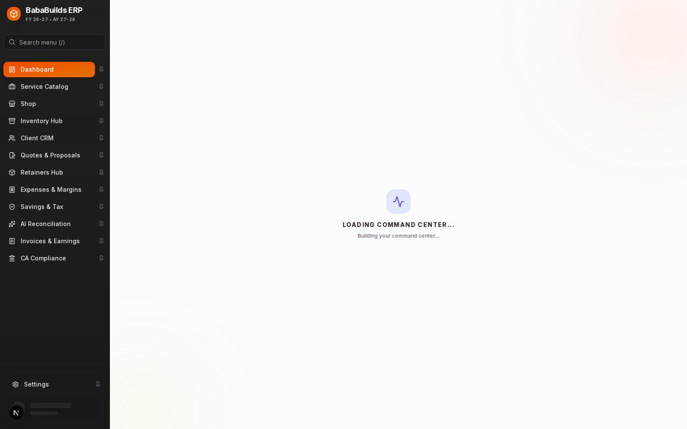
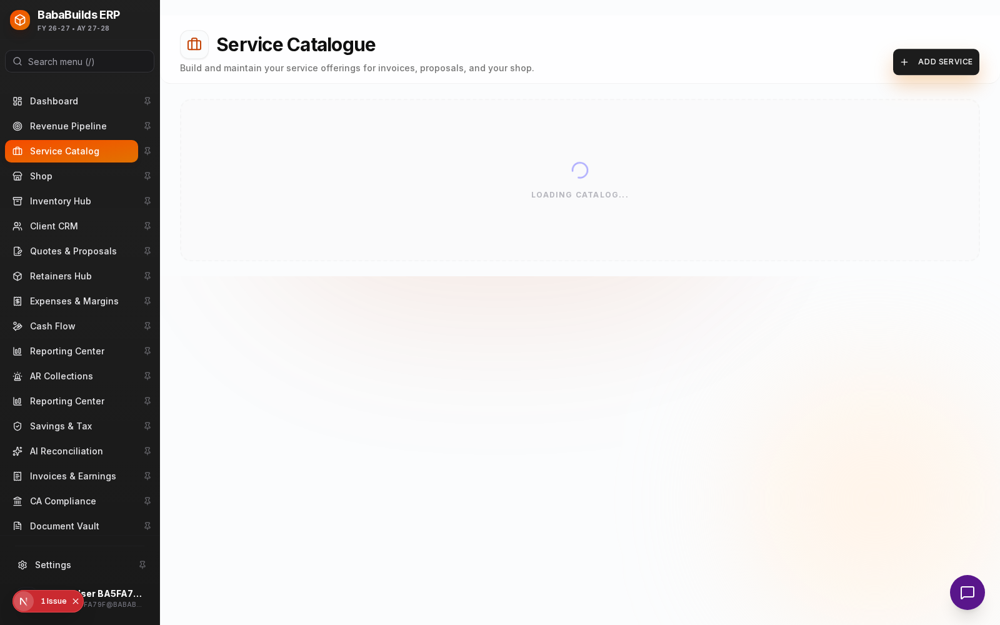
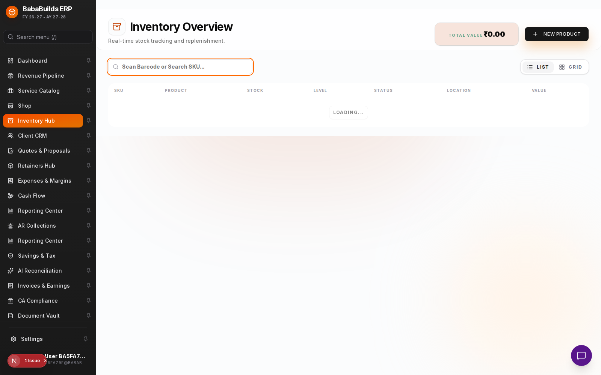
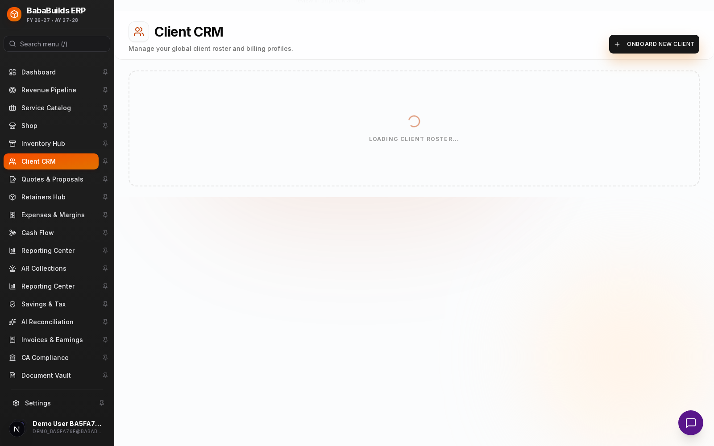
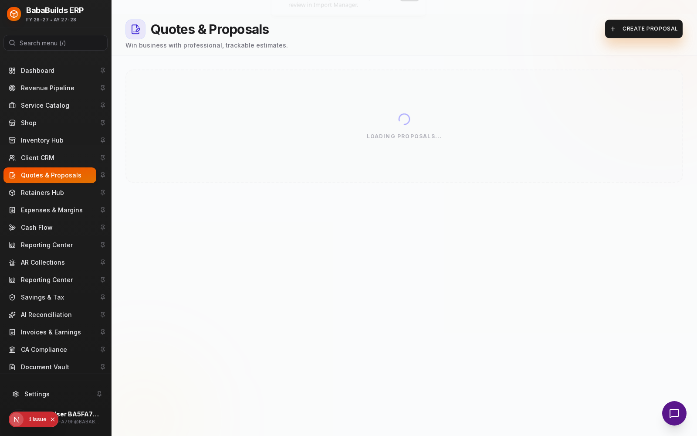
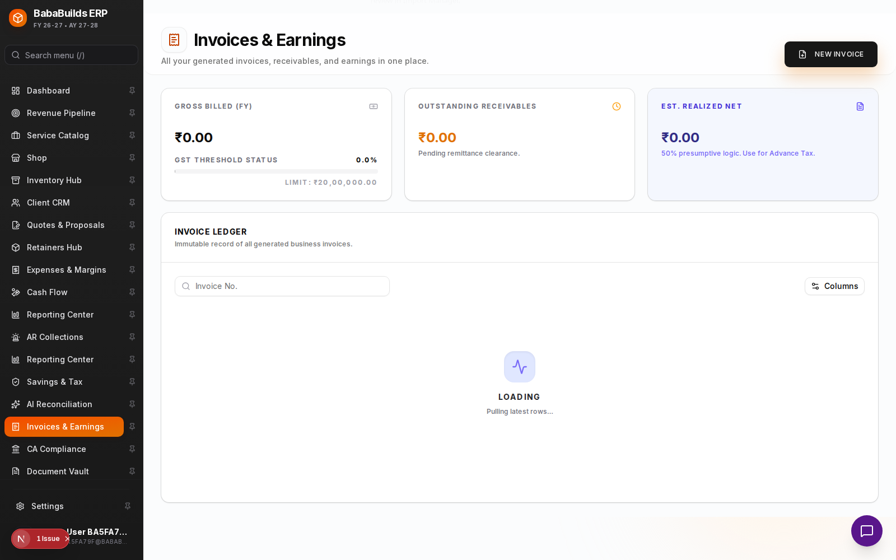

# BabaBuilds ERP


BabaBuilds ERP is a full-stack ERP and operations suite for service-first businesses.  
It combines quoting, service catalog management, shop + inventory workflows, invoicing, retainers, expenses, tax/compliance, AI-assisted reconciliation, and optional advanced modules (workforce, payroll, cash flow, reporting, and more) in one workspace-aware platform.

Built with **Next.js App Router + React Server Components + Prisma + SQLite + NextAuth**.

---

## Table of Contents

- [Product Tour (Screenshots)](#product-tour-screenshots)
- [Core Functionalities (Codebase + Schema Mapped)](#core-functionalities-codebase--schema-mapped)
- [Use Cases](#use-cases)
- [Architecture at a Glance](#architecture-at-a-glance)
- [Installation & Local Development](#installation--local-development)
- [Environment Variables](#environment-variables)
- [Auth Configuration Modes](#auth-configuration-modes)
- [Database & Prisma Notes](#database--prisma-notes)
- [Scripts You’ll Actually Use](#scripts-youll-actually-use)
- [Testing & Quality](#testing--quality)
- [Troubleshooting](#troubleshooting)
- [Documentation & Helpful Paths](#documentation--helpful-paths)

---

## Product Tour (Screenshots)

### Highlights

| Area | Screenshot |
|---|---|
| Dashboard |  |
| Service Catalog |  |
| Inventory |  |
| Clients |  |
| Quotes & Proposals |  |
| Invoices & Earnings |  |

For the full gallery index, see:  
`content/docs/help-screenshot-gallery.md`

---

## Core Functionalities (Codebase + Schema Mapped)

Based on static inspection of app modules, Prisma enums/models, scripts, and help docs.

### 1) Business setup, authentication, and access control
- NextAuth-based sign-in architecture (email and/or Google providers)
- Demo login route for local/dev onboarding
- Workspace-aware user model and role system
- Role/permission-gated feature access for optional modules

### 2) CRM & customer lifecycle
- Client management (profiles, contact and relationship data)
- Referral tracking and rewards workflow
- Proposal/quote lifecycle with conversion pathways

### 3) Revenue operations
- Service catalog operations (priceable services/products)
- Shop/order-oriented operations for sellable items
- Retainer and recurring revenue tracking
- Invoice lifecycle with schema-backed statuses:
  - `PENDING`
  - `PARTIALLY_PAID`
  - `PAID`
- Payment/revenue event tracking via accounting event types

### 4) Expense, tax, and compliance workflows
- Expense recording and categorization
- Tax workflows with readiness, blocker, and filing status concepts
- CA/audit portal workflows for finance/compliance collaboration
- Compliance task tracking via task status states

### 5) Inventory & operations hub
- Inventory management and stock operational flows
- Operational dashboard with primary action surfaces and drill-down views

### 6) AI-assisted finance tooling
- AI reconciliation workflows
- Optional cash-flow forecasting module with:
  - horizon, scenario tags, direction/source/classification enums
  - risk-level tagging and generation provenance metadata

### 7) Reporting & analytics
- Optional Reporting Center module
- Preset-driven, scoped query execution model
- Export workflows (XLSX pathway in dependencies/scripts)
- Audit logging for reporting actions

### 8) Workforce and payroll (optional modules)
- Workforce module patterns for people/process tracking
- Payroll-related optional workflows

### 9) Document and import subsystems (optional modules)
- Document Vault module surface
- Import Manager workflows for structured data intake

### 10) Partner/channel ecosystem
- Distributor, coupon attribution, and commission schema entities
- Margin basis and payout lifecycle handling
- Reseller/coupon audience concepts in schema enums

---

## Use Cases

### For founders / owner-operators
- Replace fragmented tools (spreadsheets + invoicing app + CRM + notes) with one operational system.
- Track cash in/out, invoices, retainers, and taxes from a single dashboard.

### For finance and accounting teams
- Keep clean revenue/expense visibility with audit-friendly activity trails.
- Standardize filing readiness and compliance blockers before deadlines.

### For sales and account teams
- Move from lead/referral to proposal to invoice without switching products.
- Maintain client context while coordinating with service/ops teams.

### For operations and inventory managers
- Run inventory-aware workflows alongside service catalog and order processes.
- Reduce manual handoff friction between shop floor and finance workflows.

### For growing organizations
- Start with core ERP modules, then enable optional modules (cash flow, reporting center, payroll, document vault, etc.) as maturity increases.

---

## Architecture at a Glance

- **Frontend:** Next.js 16 App Router + React 19 + TypeScript
- **Backend:** Next.js server routes / server components
- **Database:** Prisma ORM with SQLite (`prisma/dev.db` in local dev)
- **Auth:** NextAuth with provider toggles
- **Styling/UI:** Tailwind + Radix/UI utilities
- **Tests:** Vitest + Playwright smoke coverage

---

## Installation & Local Development

### 1) Clone and install

```bash
git clone <your-repo-url>
cd BabaBuilds-ERP
npm install
```

### 2) Create `.env` at repo root

Required baseline variables:

```bash
DATABASE_URL="file:./prisma/dev.db"
NEXTAUTH_URL="http://localhost:3000"
NEXTAUTH_SECRET="replace-with-a-random-secret"
AUTH_GOOGLE_ENABLED=false
AUTH_EMAIL_ENABLED=false
```

### 3) Prepare Prisma client and schema

```bash
npx prisma generate
npx prisma db push
```

(Optional) seed compliance dictionaries:

```bash
npx ts-node prisma/seed.ts
```

### 4) Run the app

```bash
npm run dev
```

Open: [http://localhost:3000](http://localhost:3000)

---

## Environment Variables

### Always required once auth is exercised
- `NEXTAUTH_URL`
- `NEXTAUTH_SECRET`

### Database
- `DATABASE_URL` (SQLite path in local dev)

### Provider toggles
- `AUTH_EMAIL_ENABLED`
- `AUTH_GOOGLE_ENABLED`

When enabling email or Google auth, set the related provider credentials as documented in [Auth Configuration Modes](#auth-configuration-modes).

---

## Auth Configuration Modes

### Mode A — Email-only auth
Set:
- `AUTH_EMAIL_ENABLED=true`
- `AUTH_GOOGLE_ENABLED=false`

Also configure SMTP/email variables:
- `EMAIL_SERVER_HOST`
- `EMAIL_SERVER_PORT`
- `EMAIL_SERVER_USER`
- `EMAIL_SERVER_PASSWORD`
- `EMAIL_FROM`

### Mode B — Google + Email auth
Set:
- `AUTH_GOOGLE_ENABLED=true`
- `AUTH_EMAIL_ENABLED=true`

Also configure:
- `GOOGLE_CLIENT_ID`
- `GOOGLE_CLIENT_SECRET`
- all SMTP/email variables above

Google OAuth callback URI:
- `https://erp.bababuilds.com/api/auth/callback/google`

---

## Database & Prisma Notes

- Local DB file: `prisma/dev.db` (gitignored)
- Use `npx prisma db push` for local schema sync.
- Avoid `npx prisma migrate dev` in this repo currently due to a known broken migration dependency (`20260407100000_invoice_status_enum` in shadow DB flow).

---

## Scripts You’ll Actually Use

```bash
npm run dev                 # Start local app
npm run lint                # ESLint + KPI coverage check
npm run typecheck           # TypeScript no-emit check
npm run validate            # Lint + typecheck + production build
npm test                    # Vitest suite
npm run test:browser:smoke  # Playwright smoke tests
npm run codex:quick         # Fast local validation loop
```

---

## Testing & Quality

- **Unit/integration tests:** Vitest
- **Browser smoke tests:** Playwright
- **Static quality gates:** ESLint + TypeScript + route/check scripts

Note: Existing lint debt is known in the codebase; treat lint output as “baseline + regressions” during active development.

---

## Troubleshooting

- **Auth fails early:** verify `NEXTAUTH_URL` and `NEXTAUTH_SECRET` are set correctly.
- **Schema mismatch/local DB issues:** run `npx prisma generate && npx prisma db push`.
- **Demo login MFA policy block:** known pre-existing bug in policy/provider whitelisting (see `lib/auth.ts` behavior).

---

## Documentation & Helpful Paths

- Main README: `README.md`
- Prisma schema: `prisma/schema.prisma`
- Screenshot index: `content/docs/help-screenshot-gallery.md`
- Screenshots folder: `public/help/screenshots/`
- Frontend rollout docs:
  - `docs/frontend/component-adoption-matrix.md`
  - `docs/frontend/visual-qa-checklist.md`

---

If you want, next PR can add:
- clickable architecture diagram,
- persona-specific quick-starts,
- a “module-to-route map” table for faster onboarding of new engineers and coding agents.
