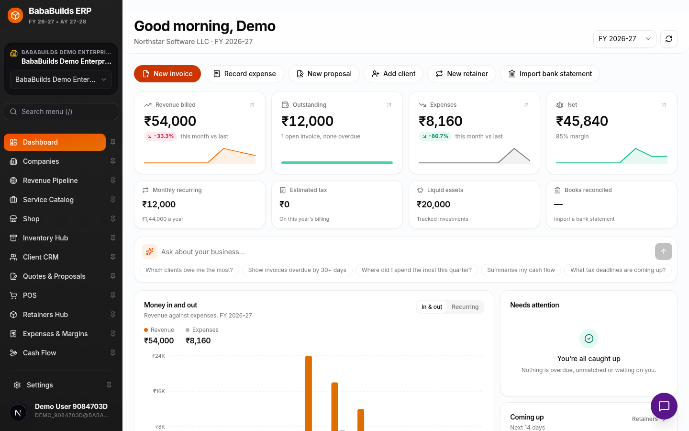

# BabaBuilds ERP product image library

This is the canonical visual record of the current product. Each screen is captured from a seeded **Software Company** demo workspace with synthetic names, balances, documents, and transactions.

## What is included

- Matching light and dark screenshots at 1440×900
- Public marketing, sign-in, and Help pages
- Core sales, operations, finance, compliance, workforce, payroll, and settings pages
- Seed-dependent detail screens such as proposal detail, payroll run detail, and the public storefront
- A machine-readable [`manifest.json`](manifest.json) with titles, routes, sections, and both asset paths

Screens are grouped by theme:

- [`screenshots/light/`](screenshots/light/)
- [`screenshots/dark/`](screenshots/dark/)

## Use the images in public material

Prefer a responsive `<picture>` so readers see the theme that matches their device:

```html
<picture>
  <source media="(prefers-color-scheme: dark)" srcset="screenshots/dark/dashboard.png">
  
</picture>
```

Keep captions outcome-focused. Explain what a customer can accomplish on the screen instead of repeating the page title. Do not crop out navigation when the surrounding product context helps the reader understand where they are.

## Refresh the library

Prepare an isolated PostgreSQL 17 database and the normal local environment, start the app, then run:

```bash
PLAYWRIGHT_CHROMIUM_EXECUTABLE_PATH=/path/to/chromium \
  npm run product-images:capture
```

The capture validates that pages do not return server errors, authenticated routes do not fall back to sign-in, the requested theme is applied, and each PNG contains meaningful visual variance. Light captures also refresh the compatibility assets used by the existing brochure build.

Use `CAPTURE_RESUME=1` only to continue an interrupted run. Leave it unset for a deliberate full refresh after a product redesign.

## Safety and publishing notes

- Capture only seeded demo data; never use a customer workspace.
- Review every image for unexpected uploads, email addresses, tokens, and browser UI before publishing.
- Keep the full-resolution masters here. Derive brochure crops or compressed web variants from these files instead of overwriting them.
- Treat [`manifest.json`](manifest.json) as generated output; update the route definitions in [`../sales-brochure/brochure-routes.ts`](../sales-brochure/brochure-routes.ts).
